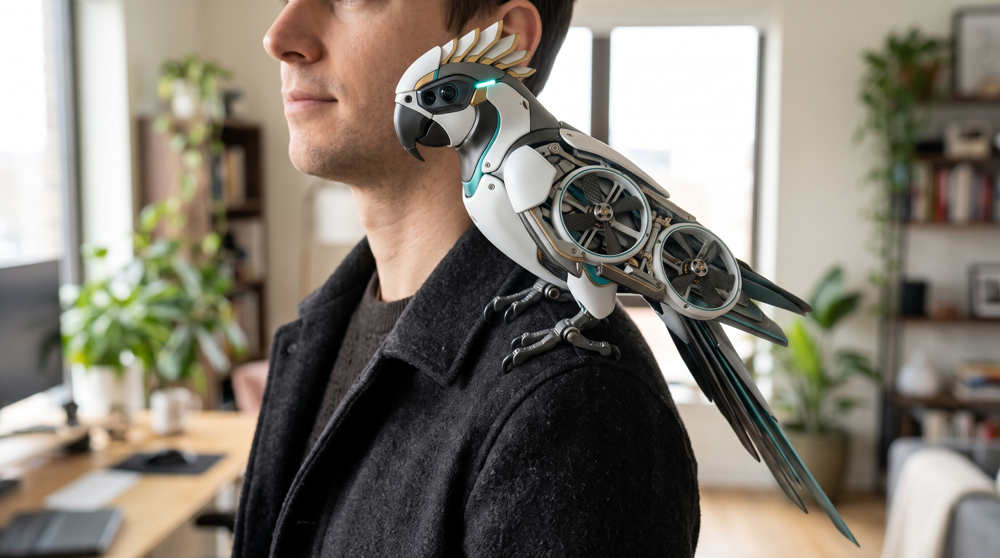

# Project Homay — A Bird-Inspired Robotic Companion

*An early vision for a small physical assistant that can stay close to its owner, help with everyday tasks, and interact with the world in ways a phone app cannot.*

  
   
  Concept illustration only — this robot has not been built. The image shows a possible direction, not the capabilities of the current prototype.

## Where the idea came from

Homay started as a lightweight, bird-inspired gripping mechanism that can be worn on the shoulder. I was interested in the idea of a useful robotic companion that stays physically close to its user, rather than another assistant confined to a phone or screen.

The current **Homay v1.0** is a voice-controlled, shoulder-mounted gripper. It does not fly, navigate autonomously, monitor health, or provide companionship. Those are possible directions for future versions, not features of the existing prototype.

My longer-term idea is to explore whether a compact, bird-like robot could combine **physical assistance, useful sensing, and a friendly presence** without needing a large humanoid body.

## Possible directions

### 1. A shoulder assistant and physical companion

A future Homay could perch on a shoulder, hold or position small objects, and help with simple hands-free tasks. Its bird-like appearance and expressive movements might also make it feel more approachable. Whether that genuinely improves comfort or companionship would need to be tested with users; appearance alone does not prove an emotional benefit.

### 2. Assistance and awareness in everyday life

With additional sensors and carefully designed feedback, the system might eventually help users notice nearby hazards or navigate their surroundings. Possible applications include support for blind or visually impaired people, optional fall or incident alerts, and basic health-related observations. Each would require its own validation: a prototype sensor cannot be treated as a reliable safety or medical device.

### 3. Hands-free filming and observation

A camera-equipped version could act as a wearable filming platform or help frame footage while its owner moves. Automatic tracking and stabilisation would need separate hardware and software development. Any recording feature would need clear user control and consideration for people nearby.

### 4. Aerial robotics and perching

The lightweight, adaptive gripping idea could also be explored separately as a **drone payload gripper** or **perching mechanism** for grasping branches, pipes or other irregular structures. A future aerial companion might travel to a charging station and return autonomously, but that would require a completely new flight and navigation system.

Landing a flying robot on a person's shoulder is **not** a near-term feature or a safe assumption. Rotor protection, collision prevention, landing stability and testing away from people would come first.

### 5. Inspection and difficult environments

A related gripper could carry a small camera or sensor on an inspection robot, attaching to structures in confined or hazardous locations. Search-and-rescue and infrastructure inspection are possible areas to investigate, but the mechanism would need to be redesigned and tested for those conditions.

## What I would explore next

I see the most useful development path as a series of smaller, testable steps rather than trying to build every feature at once:

1. **Improve the current gripper:** reduce its size, improve gripping force, and make the mechanism easier to wear and operate.
2. **Add interaction beyond voice:** explore tactile feedback or simple body-signal inputs so information can travel both ways between user and robot.
3. **Explore physical assistance and expression:** build small, non-flying prototypes to test useful everyday tasks and whether bird-like motion changes the user experience.
4. **Study specialised applications separately:** investigate drone perching, camera mounting, or inspection only where the current mechanism provides a practical advantage.

## Questions worth testing

- Can a compact shoulder-mounted robot actually help someone complete a hands-free task more easily?
- Can simple tactile cues communicate what the robot is doing without requiring the user to watch it?
- Can a single-actuator adaptive gripper remain lightweight while providing more useful grip force?
- Does a bird-like physical form make interaction more comfortable or enjoyable compared with a conventional device?

These are research and design questions, not claims of demonstrated performance.

---

*Homay is currently an independently developed experimental wearable gripper. This document describes possible applications and directions for future exploration, not a finished product or a medical, safety or aviation-certified system.*
